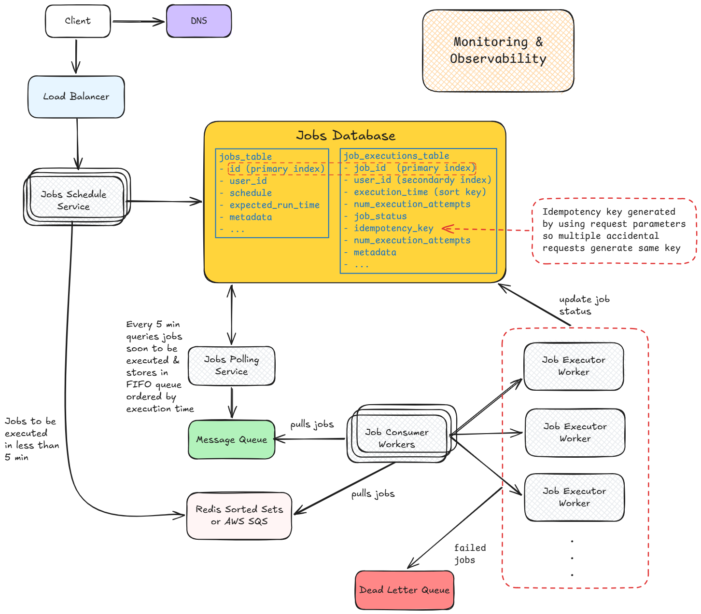
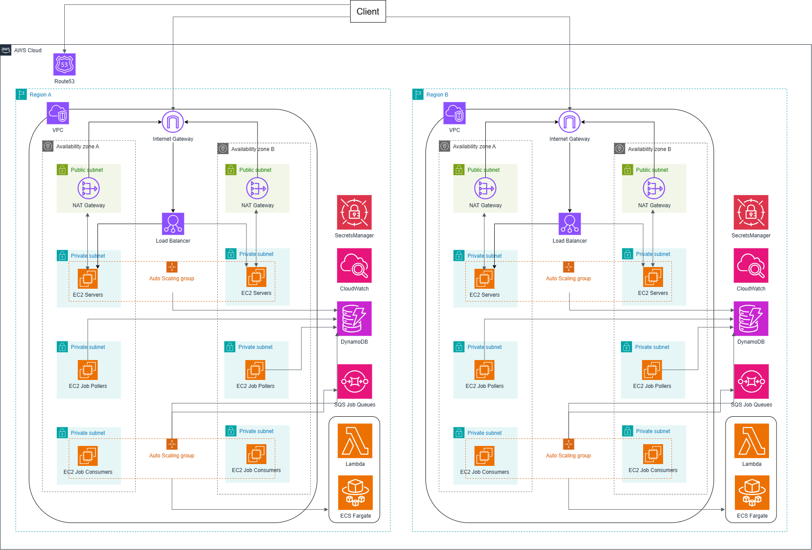

# Cloud Scale Job Schduler Project

Production-grade job scheduler platform built on AWS with Terraform.

## Features

- Multi-region architecture
- Containerized workloads
- Infrastructure as Code with Terraform
- Automated CI/CD with Github Actions
- Zero-downtime deployments
- Asynchronous job processing
- Centralized observability
- Least-privilege IAM
- Disaster recovery
- Automated security scanning

## Reliability

Availability target: 99.9%

RTO: 2 hours
RPO: 1 hour

Failure scenarios tested:

- ✓ ECS task failure
- ✓ Application deployment failure
- ✓ Worker failure
- ✓ SQS retry exhaustion
- ✓ Availability-zone failure

## Application Architecture

## AWS Architecture

Project Steps

Step 1: Application and Sytem Requirements

Step 2: Design Application Architecture

Step 3: Build a Containerized Application with secure CI/CD

Step 4: Design AWS Architecture

Step 5: Write Reusable Terraform Modules

Step 6: Deploy AWS Infra with secure CI/CD

Step 7: Deploy Containerized Application to AWS with secure CI/CD

Step 8: Load and Failure Testing, Disaster Recovery